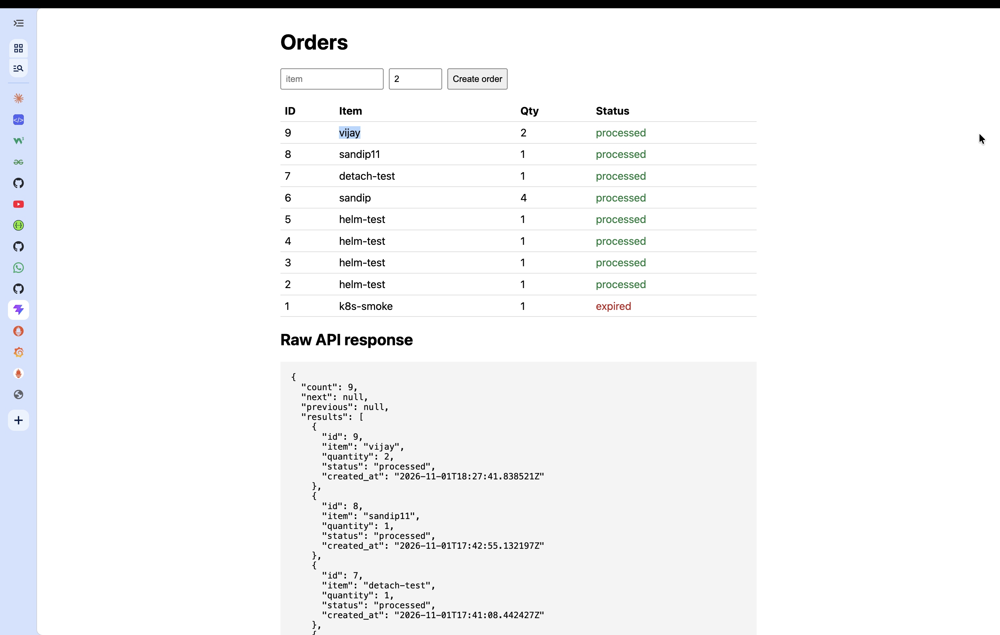
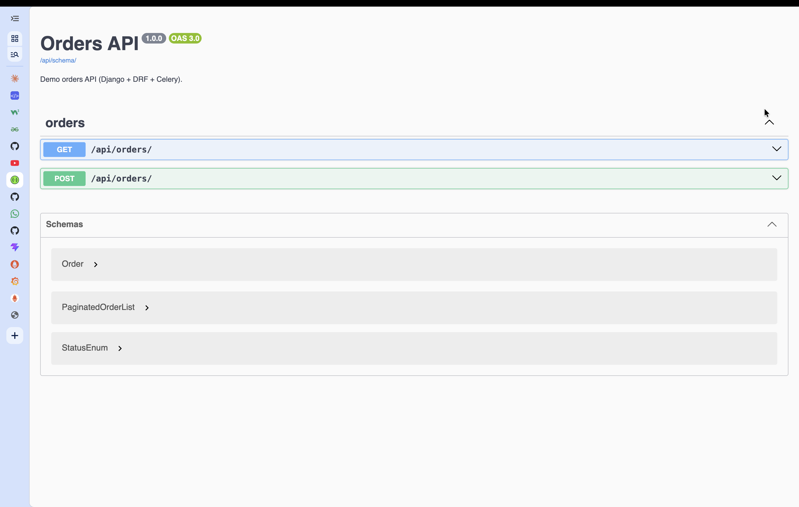
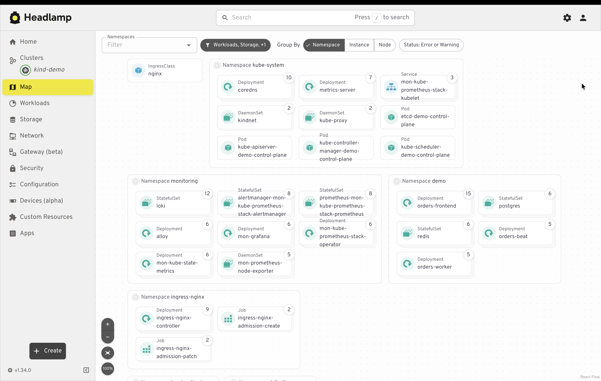
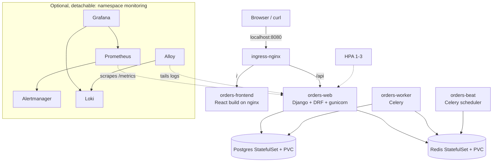

# Django on Kubernetes with Helm + Observability

A hands-on, fully local project: a Django 6 + DRF orders API with Celery workers and a React (Vite) frontend,
packaged as a Helm chart and run on a **kind** cluster (Docker Desktop), with a **detachable** observability
stack (Prometheus, Grafana, Alertmanager, Loki). Built phase by phase as interview preparation for a
Staff DevOps / Backend Engineer role (Python/Django, Docker, Kubernetes, Helm, EKS, Terraform, CI/CD, observability).

> Local only. Nothing here creates real AWS resources; Terraform (Phase 6) is `validate`/`plan` only.

## What it looks like

**Frontend (React + Vite)**: creates orders and shows the Django API response live. New orders start as
`pending` and flip to `processed` when the Celery worker handles them; stale ones become `expired` (Celery beat).



**Backend API docs (Swagger UI via drf-spectacular)**: `GET` and `POST /api/orders/`, OpenAPI 3.0 schema at `/api/schema/`.



**Live cluster (Headlamp)**: everything running in the `kind-demo` cluster, grouped by namespace.



## Architecture


Everything runs inside ONE Docker container (the kind node `demo-control-plane`), which is why Docker Desktop shows a
single container. See [docs/kind-demo-cluster-now.md](docs/kind-demo-cluster-now.md) and [docs/headlamp-guide.md](docs/headlamp-guide.md).

## Stack
| Layer | Technology |
|---|---|
| Backend | Python 3.13, Django 6.1, DRF 3.18, drf-spectacular (Swagger), Celery 5.6 (worker + beat), gunicorn, managed with **uv** |
| Frontend | React 19, Vite 8, served by `nginx-unprivileged` |
| Data | PostgreSQL 16, Redis 7 (StatefulSets with PVCs) |
| Platform | Docker Desktop, kind (Kubernetes v1.34), ingress-nginx, metrics-server |
| Packaging | Helm chart `charts/django-app` (dev and prod values, migration hook, HPA) |
| Observability | kube-prometheus-stack, Loki, Grafana Alloy, django-prometheus, JSON logs |
| Planned | Terraform (VPC + EKS, plan only), GitHub Actions (OIDC to ECR/EKS), Jenkinsfile |

## Phases

| # | Phase | Status | Doc | Test script |
|---|---|---|---|---|
| 1 | App and image | Done | [phase1-app-and-image.md](docs/phase1-app-and-image.md) | `docker compose up` smoke test |
| 2 | Cluster basics (kind, ingress, Postgres/Redis) | Done | [phase2-cluster-basics.md](docs/phase2-cluster-basics.md) | `scripts/phase2-verify.sh` |
| 3 | Helm chart | Done | [phase3-helm-chart.md](docs/phase3-helm-chart.md) | `scripts/phase3-verify.sh` (33 checks) |
| 4 | Observability (detachable) | Done | [phase4-observability.md](docs/phase4-observability.md) | `scripts/phase4-verify.sh` (24), `phase4-detach-test.sh` |
| 5 | Break and fix drills | Planned (docs only) | [phase5-break-and-fix.md](docs/phase5-break-and-fix.md) | to be written |
| 6 | AWS (Terraform/EKS) and CI on paper | Planned (docs only) | [phase6-aws-and-ci.md](docs/phase6-aws-and-ci.md) | to be written |

Learning guides: [Kubernetes concepts](docs/k8s-concepts.md) · [Helm basics](docs/helm-basics.md) ·
[Cluster snapshot](docs/kind-demo-cluster-now.md) · [Headlamp / k9s guide](docs/headlamp-guide.md)

## Quick start (from zero)
Prerequisites on an Apple-silicon Mac: Docker Desktop (about 10 GB RAM), `kind`, `kubectl`, `helm`, `uv`, Node 24.

```bash
git clone https://github.com/sandip-gavade/k8_local_demo.git && cd k8_local_demo

# Phase 1: run with docker compose (UI :3000, API :8000)
docker compose up -d --build            # .env is committed with throwaway dev values
curl localhost:8000/readyz              # {"status": "ok", "database": "ok", "redis": "ok"}
docker compose down

# Phase 2: cluster + ingress + Postgres/Redis + load images   (first run ~10 min, image pulls)
./scripts/phase2-up.sh && ./scripts/phase2-verify.sh

# Phase 3: Helm release (also installs metrics-server for the HPA)
./scripts/phase3-up.sh && ./scripts/phase3-verify.sh
open http://localhost:8080/             # React UI
open http://localhost:8080/api/docs/    # Swagger UI

# Phase 4: optional monitoring stack
./scripts/monitoring-up.sh && ./scripts/phase4-verify.sh
./scripts/monitoring-open.sh            # Grafana :3001, Prometheus :9090, Alertmanager :9093, Loki :3100

# Detach monitoring (app unaffected) / tear everything down
./scripts/monitoring-down.sh
kind delete cluster --name demo
```

## Repo layout
```
app/                 Django project, uv (pyproject.toml, uv.lock), multi-stage non-root Dockerfile
frontend/            React + Vite app, nginx Dockerfile
charts/django-app/   Helm chart (templates, values.yaml, values-dev/prod.yaml, files/dashboard.json)
k8s/infra/           Postgres + Redis StatefulSets, namespace
kind/                kind cluster config (port mappings 8080/8443)
observability/       Helm values for kube-prometheus-stack, Loki, Alloy
scripts/             up / verify / monitoring scripts (each phase ends with a test)
docs/                one doc per phase + concept guides + screenshots
docker-compose.yml   Phase 1 smoke test
```

## Notable design choices
- **Security defaults:** non-root containers, read-only root filesystems, dropped capabilities, no ServiceAccount token mounted, resource requests/limits everywhere, pinned versions (no `latest`).
- **Zero-downtime and safe releases:** `maxUnavailable: 0`, startup/liveness/readiness probes (liveness never checks dependencies), migrations as a `pre-upgrade` Helm hook, `--rollback-on-failure`.
- **Observability is optional:** the stack lives in its own namespace and the app chart renders its monitoring objects only when `observability.enabled=true`.
- **Celery beat is never scaled** (single replica, `Recreate` strategy).

## Security note
`.env` is committed on purpose for this local demo and contains only throwaway values (`dev-only-secret-123`).
For anything real: remove it from git, keep secrets in a Secret manager (External Secrets / AWS Secrets Manager),
and reference them from the cluster. `scripts/create-secrets.sh` already creates the Kubernetes Secret from `.env`
rather than from a manifest.
