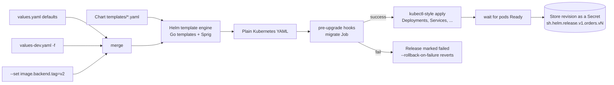
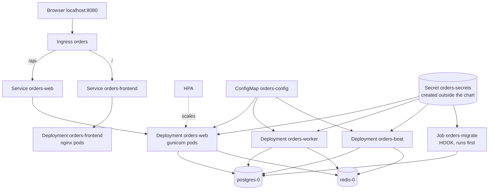

# Helm basics: why, what, and how we wrote our chart

Read after `k8s-concepts.md`. Everything here is shown with real output from this repo's chart
(`charts/django-app/`). Diagrams are Mermaid (GitHub renders them) plus plain-text.

---

## 1. The problem Helm solves

Our app needs these Kubernetes objects: 4 Deployments, 2 Services, 1 Ingress, 1 ConfigMap, 1 HPA,
1 ServiceAccount, 1 migration Job. That is ~11 YAML objects. Without Helm:

| Pain | Example from our project |
|---|---|
| **Repetition** | Same labels, same securityContext, same image repeated in 4 Deployments. Change one, forget three. |
| **Environments** | dev needs 1 replica + `django-app:dev`; prod needs 2+ replicas + an ECR image + TLS. Copy-pasting YAML per env drifts. |
| **No versioned release** | `kubectl apply` of 11 files has no "revision 5", no one-command rollback. |
| **No ordering / gates** | Migrations must finish BEFORE new pods start. Plain YAML cannot express that. |
| **Manual cleanup** | Removing the app means remembering every object. |

Helm = **templates + values + release tracking**:
- Write the YAML once with placeholders (templates).
- Fill the placeholders from a values file per environment.
- Install everything as one named, versioned **release** that can be upgraded, rolled back, uninstalled.

Analogy: a template is a form letter, `values.yaml` is the list of names and addresses, and Helm is the
mail room that sends all the letters and keeps a copy of each batch so it can recall it.

---

## 2. Three words to get straight

| Term | Meaning | Ours |
|---|---|---|
| **Chart** | A folder of templates + defaults (the package) | `charts/django-app/` |
| **Release** | One installed instance of a chart in a cluster, with a name | `orders` in namespace `demo` |
| **Revision** | Each install/upgrade/rollback of a release gets the next number | `helm history orders -n demo` |

One chart can be installed many times (`orders-dev`, `orders-staging`), each a separate release.

---

## 3. The flow (what happens when you run `helm upgrade --install`)



Text version:
```
 values.yaml  <-  values-dev.yaml  <-  --set a.b=c        (later wins)
        \               |                 /
         \______________|________________/
                        v
   templates/*.yaml  --(render)-->  plain Kubernetes YAML
                        v
   pre-upgrade hook (migrate Job)  --fail--> revision "failed", roll back
                        v ok
   apply Deployments / Services / Ingress / ConfigMap / HPA
                        v
   wait until pods Ready  -->  save revision N as a Secret in the namespace
```

Helm itself is only a client: no server component. It stores release history as Secrets in your
namespace (we have them: `kubectl -n demo get secret -l owner=helm` shows `sh.helm.release.v1.orders.v4 ... v13`).
That history is what `helm history` and `helm rollback` read.

---

## 4. Our chart's structure, visually

```
charts/django-app/
├── Chart.yaml            <- name + version metadata
├── values.yaml           <- DEFAULTS for every setting
├── values-dev.yaml       <- override: small, local (kind)
├── values-prod.yaml      <- override: EKS, ECR images, TLS, 2+ replicas
└── templates/
    ├── _helpers.tpl      <- reusable named snippets (NOT a manifest; "_" = skip)
    ├── NOTES.txt         <- message printed after install
    ├── serviceaccount.yaml
    ├── configmap.yaml            --> ConfigMap  orders-config
    ├── secret.yaml               --> only if secret.create=true
    ├── deployment-web.yaml       --> Deployment orders-web
    ├── deployment-worker.yaml    --> Deployment orders-worker
    ├── deployment-beat.yaml      --> Deployment orders-beat
    ├── deployment-frontend.yaml  --> Deployment orders-frontend
    ├── service.yaml              --> Service orders-web + orders-frontend (one loop)
    ├── ingress.yaml              --> Ingress orders  (/api -> web, / -> frontend)
    ├── hpa.yaml                  --> HPA orders-web (if hpa.enabled)
    └── migrate-job.yaml          --> Job, run as a pre-install/pre-upgrade HOOK
```

How the pieces connect in the running cluster:



Rule of thumb: **one template file per Kubernetes object kind (or per component)**.
`service.yaml` is the exception: a `range` loop produces two Services from one file.

---

## 5. How a template works: placeholders become YAML

Helm templates are normal Kubernetes YAML with `{{ ... }}` actions (Go templates). Three sources of data:

| Expression | Data source | Example |
|---|---|---|
| `.Values.x.y` | merged values files | `.Values.web.replicas` |
| `.Release.Name`, `.Release.Namespace` | the install command | `orders`, `demo` |
| `.Chart.Name`, `.Chart.Version` | `Chart.yaml` | `django-app`, `0.1.0` |

### Example A: values -> ConfigMap
`values.yaml`:
```yaml
config:
  DJANGO_DEBUG: "0"
  POSTGRES_HOST: postgres
  LOG_LEVEL: INFO
```
`templates/configmap.yaml`:
```yaml
data:
{{- range $k, $v := .Values.config }}
  {{ $k }}: {{ $v | quote }}
{{- end }}
```
Rendered (`helm template ... -s templates/configmap.yaml`):
```yaml
data:
  DJANGO_ALLOWED_HOSTS: "*"
  DJANGO_DEBUG: "0"
  LOG_LEVEL: "INFO"
  POSTGRES_HOST: "postgres"
  ...
```
Add a new key to `config:` in values and it appears in the ConfigMap with NO template change. That is the point.

### Example B: a loop makes two Services from one file
```yaml
{{- range $component, $port := dict "web" .Values.web.port "frontend" .Values.frontend.port }}
---
kind: Service
metadata:
  name: {{ include "django-app.fullname" $ }}-{{ $component }}
spec:
  ports: [{name: http, port: {{ $port }}, targetPort: http}]
{{- end }}
```
Renders `Service orders-web` (port 8000) and `Service orders-frontend` (port 8080). Inside `range`, `.` changes,
so `$` is used to reach the root context.

### Example C: one value flowing into a Deployment
```
helm template ... --set image.backend.tag=v2     renders ->     image: django-app:v2
```
Template line: `image: {{ include "django-app.backendImage" . }}` where the helper is
`{{ .Values.image.backend.repository }}:{{ .Values.image.backend.tag }}`.
In CI the tag is the git SHA: `--set image.backend.tag=$GITHUB_SHA`.

### Example D: conditionals
```yaml
{{- if not .Values.hpa.enabled }}
replicas: {{ .Values.web.replicas }}
{{- end }}
```
If the HPA is on, the `replicas:` line is omitted so `helm upgrade` doesn't fight the autoscaler.
`ingress.yaml`, `hpa.yaml`, `secret.yaml`, `migrate-job.yaml` are wrapped in `{{- if ... }}` the same way.

### Syntax cheat sheet
| Syntax | Meaning |
|---|---|
| `{{ .Values.a }}` | print a value |
| `{{- ... }}` / `{{ ... -}}` | the `-` trims whitespace/newline on that side (YAML is whitespace-sensitive) |
| `{{ $v \| quote }}` | pipe to a function: wrap in quotes |
| `{{ toYaml .Values.resources \| nindent 12 }}` | dump a map as YAML, newline + indent 12 spaces |
| `{{ include "name" . }}` | call a named template, result can be piped (unlike `template`) |
| `{{ define "name" }}...{{ end }}` | declare a named template (in `_helpers.tpl`) |
| `{{ range ... }}`, `{{ if ... }}`, `{{ with ... }}` | loop, condition, scope-change |
| `{{ default "x" .Values.y }}` | fallback |
| `{{ sha256sum }}` | hash (used for config checksum) |

---

## 6. `_helpers.tpl`: DRY snippets

Defined once, called from everywhere:
```yaml
{{- define "django-app.labels" -}}
helm.sh/chart: {{ include "django-app.chart" . }}
app.kubernetes.io/instance: {{ .Release.Name }}
app.kubernetes.io/managed-by: {{ .Release.Service }}
{{- end -}}
```
Used as `labels: {{- include "django-app.labels" . | nindent 4 }}` in every template, so every object gets
identical labels (this is also how `helm` and dashboards group things). Our helpers: names, labels,
**selector labels** (kept minimal because a Deployment's `selector` is immutable), image strings,
secret env block.

---

## 7. Values: layers and precedence

```
values.yaml (chart defaults)
   < -f values-dev.yaml              (environment file)
      < -f another.yaml              (later -f wins)
         < --set image.backend.tag=abc   (command line wins over everything)
```
Merge is per-key (deep merge for maps; lists are replaced whole).

| What changes between envs | dev | prod |
|---|---|---|
| image | `django-app:dev` (loaded into kind) | ECR URL, tag from CI |
| pullPolicy | IfNotPresent | Always |
| web replicas | 1 (HPA 1-3) | 2 (HPA 2-10) |
| DB / Redis | in-cluster StatefulSets | RDS / ElastiCache hosts |
| ingress | any host | `orders.example.com` + TLS |

Inspect what's actually deployed:
```bash
helm get values orders -n demo            # only what you overrode
helm get values orders -n demo --all      # merged result
helm get manifest orders -n demo          # the exact YAML that was applied
```

---

## 8. Hooks and release features (the part plain `kubectl` can't do)

**Hook:** a resource with `helm.sh/hook` annotations, run at a lifecycle moment instead of being part of
the normal set.
```yaml
annotations:
  "helm.sh/hook": pre-install,pre-upgrade      # run BEFORE the new pods are created
  "helm.sh/hook-weight": "0"                   # order among hooks (low first)
  "helm.sh/hook-delete-policy": before-hook-creation,hook-succeeded
```
Our `migrate-job.yaml` uses it: if `manage.py migrate` fails, the upgrade stops, nothing new rolls out, and
`--rollback-on-failure` reverts. (Remember the gotcha: hooks run before the chart's ServiceAccount/ConfigMap exist.)

| Feature | Command | Notes |
|---|---|---|
| Install or upgrade | `helm upgrade --install orders charts/django-app -n demo -f values-dev.yaml` | idempotent |
| Auto-revert on failure | `--rollback-on-failure` (old name `--atomic`) | waits until pods Ready |
| History | `helm history orders -n demo` | one row per revision |
| Rollback | `helm rollback orders 3 -n demo` | creates a NEW revision with revision 3's content; DB changes are NOT undone |
| Uninstall | `helm uninstall orders -n demo` | removes everything it created (not the PVCs/Secret we made outside) |
| Preview | `helm template`, `--dry-run=server`, `helm diff` (plugin) | see before you apply |

---

## 9. How we created our chart: the actual steps

1. **Start from working plain YAML** (the app already ran under `docker compose`; Postgres/Redis manifests existed).
   Never write a chart before you know the raw manifests work.
2. **Scaffold:** `helm create charts/django-app`, then deleted the sample templates and wrote our own
   (or just create `Chart.yaml`, `values.yaml`, `templates/`).
3. **Write one real Deployment as plain YAML**, make sure it works with `kubectl apply`.
4. **Find what varies** and move it to values: image repo/tag, replicas, resources, config, ingress host, HPA on/off.
   Rule: if it differs between environments or you might tune it, it is a value; otherwise hard-code it.
5. **Replace the literals with `{{ .Values.x }}`** and put the defaults in `values.yaml`.
6. **Extract repeats into `_helpers.tpl`** (labels, names, image string, secret env block).
7. **Copy the Deployment for worker/beat/frontend**, changing command, probes and resources.
8. **Add the supporting objects:** Service, Ingress, ConfigMap, HPA, ServiceAccount, migrate Job (as hook).
9. **Iterate with the fast loop:**
   ```bash
   helm lint charts/django-app -f charts/django-app/values-dev.yaml              # syntax/semantic checks
   helm template orders charts/django-app -n demo -f charts/django-app/values-dev.yaml   # see rendered YAML
   helm template ... -s templates/service.yaml                                    # one file only
   helm upgrade --install orders ... --dry-run=server                             # API server validates it
   helm upgrade --install orders ... --rollback-on-failure                        # real install
   ```
10. **Add `values-prod.yaml`** with only the differences.
11. **Test the lifecycle:** upgrade, bad release (auto-rollback), manual rollback (`scripts/phase3-verify.sh`).

### How to "see" a chart
| I want to see... | Command |
|---|---|
| The final YAML Helm will apply | `helm template orders charts/django-app -n demo -f charts/django-app/values-dev.yaml` |
| One template's output | add `-s templates/deployment-web.yaml` |
| What's deployed right now | `helm get manifest orders -n demo` |
| The values in use | `helm get values orders -n demo --all` |
| Revisions | `helm history orders -n demo` |
| Objects the release owns | `kubectl -n demo get all -l app.kubernetes.io/instance=orders` |
| Graph/GUI | Lens or k9s for live objects; `helm template ... \| kubectl-neat` for tidy YAML |

---

## 10. Before / after: why it was worth it

| Task | Plain YAML | Our chart |
|---|---|---|
| Change image for all 3 Python workloads | edit 3 files | `--set image.backend.tag=v2` |
| Make a prod variant | copy 11 files, edit | `-f values-prod.yaml` (about 40 lines) |
| Roll out ConfigMap change | edit + manually restart pods | upgrade; checksum annotation rolls pods |
| Run migrations before rollout | manual step / script | pre-upgrade hook, release fails if it fails |
| Undo a bad deploy | find the old YAML | `helm rollback orders N` |
| Remove the app | delete 11 objects by name | `helm uninstall orders` |

---

## 11. Common mistakes (and how to spot them)

| Symptom | Cause |
|---|---|
| `error converting YAML to JSON` / `mapping values are not allowed` | indentation after `include ... \| nindent N` is off; run `helm template` to see it |
| Value silently ignored | typo in key path (`.Values.web.replica`); missing keys render empty, not as errors |
| `field is immutable` on upgrade | changed a Deployment `selector` (never put version labels in selectors) |
| Pods not restarting after ConfigMap edit | no checksum annotation |
| Unquoted `"true"`/numbers becoming booleans/ints in env | always `quote` env values |
| Secrets in git | never put them in `values*.yaml`; reference an existing Secret |
| Hook fails with `not found` | hooks run before the chart's other resources exist |
| Upgrade resets HPA replicas | omit `replicas` when HPA is enabled |

---

## 12. Interview answers

- **Why Helm?** Templating, per-env values, versioned releases with rollback, and hooks. Kustomize overlays are the alternative: no templating language, patch-based, no release history.
- **Helm vs Kustomize?** Helm for packaging and distributing apps with lifecycle (hooks, rollback); Kustomize for patching plain YAML per env. They can be combined (Argo CD / Flux support both).
- **Where does Helm store state?** As Secrets (`sh.helm.release.v1.<name>.v<N>`) in the release namespace. No server (Helm 3 removed Tiller).
- **What does `helm upgrade --install` do?** Installs if the release doesn't exist, else upgrades. Idempotent, which is why CI uses it.
- **What does a rollback actually do?** Re-applies an old revision's manifests as a new revision. It doesn't revert data or DB migrations.
- **Values precedence?** chart defaults < `-f` files in order < `--set`.
- **What is a library chart?** `type: library`, contains only named templates; other charts depend on it to share helpers.
- **How do you test a chart?** `helm lint`, `helm template`, `--dry-run=server`, `helm test` hooks, and install into a throwaway kind cluster in CI.
- **How do you handle secrets with Helm?** Don't keep them in values. Reference an existing Secret created by External Secrets / Sealed Secrets / SOPS (helm-secrets).
