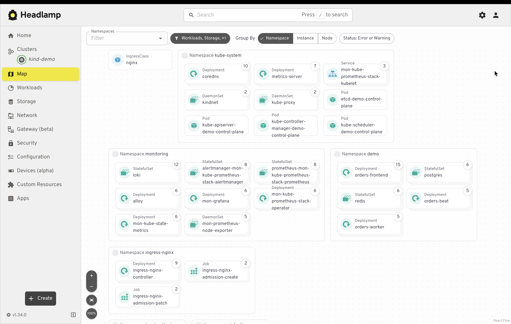

# The `kind-demo` cluster, as it is now

Two pictures describe the same cluster:

| Picture | What it is |
|---|---|
| `kind_demo_cluster_now.svg` (architecture diagram) | A hand-made map of the **app** side: how traffic flows and what runs in namespace `demo`. Snapshot from before the monitoring stack was added, at Helm revision 13. |
| `headlamp.png` (live Headlamp "Map" view) | The **real cluster, live**, grouped by namespace. It also shows `monitoring`, `ingress-nginx` and `kube-system`. |





---

## 1. Reading the architecture diagram, top to bottom

```
 kubectl / k9s / Headlamp ──► localhost:52579 ──► API server :6443   (the control door, random port set by kind)

 Browser / curl ──► localhost:8080 ──► node port 80 ──► ingress-nginx-controller
                                                           │  Ingress rules (/api, /)
                                          ┌────────────────┴───────────────┐
                                  Service orders-frontend :8080     Service orders-web :8000
                                          │                                  │
                                  Deployment orders-frontend         Deployment orders-web  ◄── HPA 1-3 pods (cpu target 70%)
                                  (nginx + React)                    (Django + gunicorn)
                                                                        │          │
                      no Service: workers pull jobs from Redis   orders-worker   orders-beat
                                                                    (Celery)       (Celery scheduler)
                                                  └───────────┬───────────┘
                                              DNS names "postgres" and "redis"
                                          ┌───────────────────┴──────────────────┐
                                   StatefulSet postgres-0                  StatefulSet redis-0
                                   headless Service :5432                  Service :6379
                                   PVC data-postgres-0 (1Gi)               PVC data-redis-0 (1Gi)
```

| Box in the diagram | What it is | Why it looks that way |
|---|---|---|
| **Node `demo-control-plane`** | ONE Docker container acting as the whole Kubernetes node | kind runs a node as a container. Pods run *inside* it. |
| **Control plane (kube-system)** | kube-apiserver, etcd, kube-scheduler, controller-manager | They run as pods on the same node (a single-node cluster). |
| **ingress-nginx-controller** | The "front door" pod, namespace `ingress-nginx` | Listens on node port 80, which the kind config maps to your Mac's `localhost:8080`. |
| **Ingress rules** | One Ingress object `orders` | `/api` goes to web, everything else goes to frontend. |
| **orders-frontend** | Deployment, nginx serving the React build | Service `:8080`. |
| **orders-web** | Deployment, Django + gunicorn | Service `:8000`. Scaled by an **HPA** between 1 and 3 pods. |
| **orders-worker / orders-beat** | Celery worker and scheduler | **No Service**: nothing calls them. They pull jobs from Redis and talk to Postgres, so nothing needs to reach them. |
| **postgres-0 / redis-0** | StatefulSets with a PVC each | Stable name + own disk. Postgres is a headless Service (`CLUSTER-IP: None`), so DNS returns the pod directly. |
| **orders-secrets** | A Secret with 2 keys | Created by `scripts/create-secrets.sh`, outside the Helm chart. |
| **Helm: orders** | The release that owns the 4 app Deployments, Services, Ingress, ConfigMap, HPA | Helm keeps the last 10 revisions. |
| **3 old ReplicaSets (0 pods)** | Previous versions of Deployments | Kept for rollback. Today there are 6 because of more upgrades. |
| Colour code | green = Deployment (stateless), blue = StatefulSet + PVC (data), grey = infra / config | |

## 2. Current state (checked live on 2026-11-02)

| Item | Value |
|---|---|
| Cluster / context | `kind-demo`, 1 node `demo-control-plane`, Kubernetes v1.34.0, containerd 2.1.3 |
| Node resources | about 43% memory (4.3 GiB used; Docker Desktop has about 9.7 GiB) |
| Pods per namespace | `demo` 6, `monitoring` 8, `ingress-nginx` 3, `kube-system` 9, `local-path-storage` 1 |
| App Deployments | orders-frontend, orders-web, orders-worker, orders-beat: all 1/1 |
| Data | StatefulSets postgres and redis 1/1, PVCs `data-postgres-0`, `data-redis-0` (1Gi, Bound, StorageClass `standard`) |
| Services | orders-frontend :8080, orders-web :8000, postgres (headless) :5432, redis :6379 |
| Ingress | `orders` (class nginx), reachable at `localhost` |
| HPA | `orders-web`, cpu about 4% of 70%, 1 to 3 replicas |
| Helm release | `orders`, **revision 16** (the diagram says 13: it predates the monitoring work) |
| Containers inside the node | about 30 (`docker exec demo-control-plane crictl ps`), versus the **1** that Docker Desktop shows |
| Optional stack | namespace `monitoring`: Prometheus, Alertmanager, Grafana, Loki, Alloy, operator, kube-state-metrics, node-exporter (detachable, see `phase4-observability.md`) |

## 3. What the Headlamp screenshot adds

Grouped by namespace:

| Namespace | What you see | Notes |
|---|---|---|
| `kube-system` | coredns (DNS), metrics-server (feeds the HPA and `kubectl top`), kindnet (networking), kube-proxy, plus the control-plane pods apiserver / etcd / scheduler / controller-manager | The cluster's own plumbing. Don't edit. |
| `monitoring` | StatefulSets `loki`, `alertmanager-...`, `prometheus-...`; Deployments `alloy`, `mon-grafana`, operator, kube-state-metrics; DaemonSet node-exporter | The detachable observability stack. |
| `demo` | Deployments orders-frontend / orders-worker / orders-beat; StatefulSets postgres and redis | Our app. `orders-web` sits below the visible area. |
| `ingress-nginx` | The controller Deployment and two completed admission Jobs | The Jobs only create the webhook certificate at install time. |
| (left) | `IngressClass nginx` | Tells Ingress objects which controller handles them. |

The small number badges on each box (10, 7, 12...) are **counts of related objects** (pods, ReplicaSets, ConfigMaps,
etc. that hang off it), not replica counts. Replica counts come from the Workloads page.

## 4. Why Docker Desktop shows only one container

| Layer | Managed by | Visible in Docker Desktop? |
|---|---|---|
| `demo-control-plane` | Docker | Yes, one row |
| Pods inside it | containerd **inside** the node | No |
| Docker Desktop's "Kubernetes" tab | Docker's own built-in cluster | No, it doesn't know about kind |

See `headlamp-guide.md` for how to look inside.

## 5. Commands that match the diagram

```bash
kubectl get nodes -o wide                                   # the one node + runtime
kubectl get pods -A                                         # everything, all namespaces
kubectl -n demo get deploy,sts,svc,ingress,hpa,pvc          # the diagram's "demo" box in text
kubectl -n demo get rs                                      # old ReplicaSets (rollback targets)
kubectl -n demo get endpoints                               # which pod IPs sit behind each Service
helm history orders -n demo                                 # revisions
docker exec demo-control-plane crictl ps                    # the real containers inside the node
```
