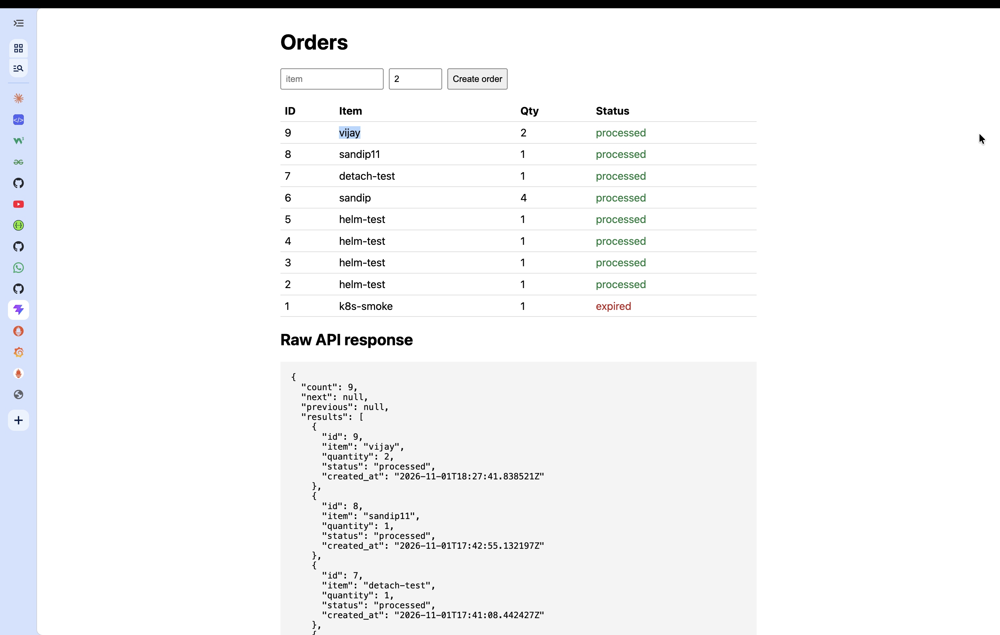
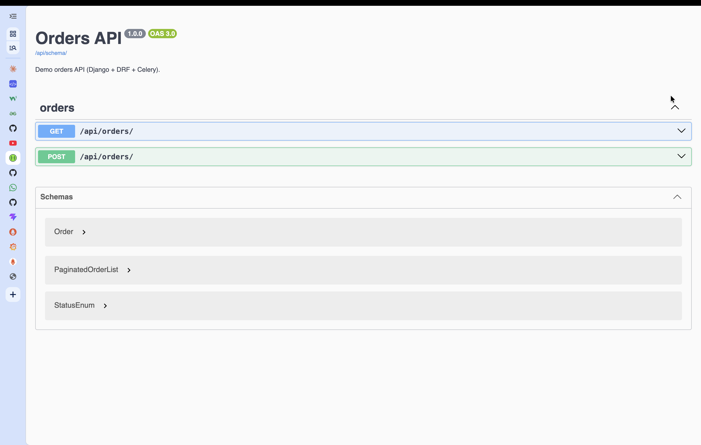

# Phase 1: App and image (Django + DRF + Celery + React), step by step

Status: **Done and tested.** Goal: a small orders application that runs under `docker compose` with secure,
reproducible images, so later phases only have to deploy it.




## What was built
| Piece | Path | Notes |
|---|---|---|
| Django 6.1 project | `app/config/` | Settings read env vars (12-factor). `DJANGO_SECRET_KEY` and `POSTGRES_PASSWORD` have no defaults: the app fails fast if they are missing. |
| Orders API | `app/orders/` | `GET` and `POST /api/orders/` (DRF, paginated). Model `Order(item, quantity, status, created_at)`; status is `pending`, `processed` or `expired`. |
| Celery tasks | `app/orders/tasks.py` | `process_order` (async, fired on create) and `expire_stale_orders` (periodic, Celery beat, every 60 s). |
| Health endpoints | `app/core/views.py` | `/healthz` = liveness (touches nothing), `/readyz` = readiness (checks Postgres and Redis, returns 503 if either is down). |
| Swagger | `/api/docs/`, `/api/schema/` | drf-spectacular, OpenAPI 3.0. |
| React frontend | `frontend/` | Vite + React 19. Lists orders, creates orders, polls every 3 s, shows the raw JSON response. Same-origin `/api` calls (Vite proxy in dev, nginx / Ingress later), so no CORS. |
| Images | `app/Dockerfile`, `frontend/Dockerfile` | Multi-stage, non-root (UID 10001 / 101), no build tools in runtime image. |
| Compose stack | `docker-compose.yml` | postgres, redis, migrate (one-shot), web, worker, beat, frontend. |

## Steps (manual version)
```bash
# 1. Backend with uv (Python 3.13: Django 6.1 needs 3.12+)
cd app
uv init --bare --no-workspace --name orders-api --python 3.13
uv add "django>=6.1,<6.2" djangorestframework celery redis "psycopg[binary]" gunicorn drf-spectacular
uv run python manage.py test            # needs Postgres; easier inside compose (see step 4)

# 2. Frontend
cd ../frontend && npm create vite@latest . -- --template react && npm install && npm run build

# 3. Local secrets for compose (dev-only values)
cd .. && cp .env.example .env

# 4. Run everything
docker compose up -d --build
docker compose ps
```

## Verify
```bash
curl localhost:8000/healthz             # {"status": "ok"}
curl localhost:8000/readyz              # {"status": "ok", "database": "ok", "redis": "ok"}
curl -XPOST localhost:3000/api/orders/ -H 'content-type: application/json' -d '{"item":"widget","quantity":2}'
sleep 3; curl localhost:3000/api/orders/    # the order's status is now "processed" (Celery ran)
docker compose exec web id              # uid=10001(app)
docker compose exec -T web python manage.py test     # 3 tests, OK
open http://localhost:3000   http://localhost:8000/api/docs/
docker compose down
```
Expected: the order is created as `pending` and becomes `processed` within a second or two; the web
container runs as uid 10001; compose ports are UI `3000`, API `8000`.

## Decisions and why
| Decision | Reason |
|---|---|
| **uv** with a committed `uv.lock`; image builds with `uv sync --frozen --no-dev` | Reproducible installs, fast builds, no dev dependencies in the image |
| Multi-stage Dockerfile; builder holds uv, runtime copies only `/opt/venv` | Smaller image, smaller attack surface, no compilers or package manager at runtime |
| Fixed numeric UID 10001, `USER 10001:10001` | Lets Kubernetes `runAsNonRoot` be verified |
| App writes only to `/tmp` and `/dev/shm` | Compatible with `readOnlyRootFilesystem` (used from Phase 3) |
| Settings from env; no default secrets | Same image in every environment; config injected by ConfigMap/Secret |
| `transaction.on_commit(lambda: process_order.delay(...))` | The worker must not run before the order row is committed (classic Celery race) |
| Liveness does not check dependencies | A database blip must not make Kubernetes restart healthy pods; readiness is the one that checks them |
| nginx-unprivileged for the frontend (port 8080) | Passes `runAsNonRoot` without root-only port 80 |
| Celery beat schedule file in `/tmp` | Writable path on a read-only filesystem |

## Problems we hit (interview stories)
1. **uv edited a file outside the project.** `uv init` found a `pyproject.toml` in the parent folder and added a `[tool.uv.workspace]` block to it. Fixed by reverting and using `uv init --no-workspace`. Lesson: check `git status` in parent folders; stray workspace files change tool behaviour.
2. **The git repo was the parent folder**, not the project, so adding `origin` there would have pushed unrelated projects. Fixed with a fresh `git init` inside the project. Lesson: `git rev-parse --show-toplevel` before the first push.
3. **SSH push failed**: the Mac's SSH key belonged to a different GitHub account than the repo owner. Pushed over HTTPS with the `gh` credential helper instead.

## Interview prep
**Talking point:** "I built a Django 6 and DRF orders API with Celery workers and a React front end. Each part is its own non-root, multi-stage image. Dependencies are pinned in `uv.lock`, so builds are reproducible. Liveness and readiness are separate endpoints: liveness never touches the database, so a database blip can't restart healthy pods."

| Question | Short answer |
|---|---|
| Liveness vs readiness? | Liveness failing restarts the container. Readiness failing only removes the pod from Service endpoints. |
| Why `transaction.on_commit` before `.delay`? | Otherwise the worker can pick the task up before the row is committed and find nothing. |
| Why multi-stage and non-root? | Smaller image, no build tools or package manager at runtime, fixed UID so `runAsNonRoot` can be checked. |
| Why not bake secrets into the image? | Images get pushed to registries and shared; secrets must come from the runtime (Secret / secret manager). |
| Why separate web, worker and beat? | They scale and fail differently. Web scales with traffic, workers with queue depth, beat must stay at exactly 1. |
| Why `uv.lock`? | Exact transitive versions and hashes, so every build installs the same thing. |
