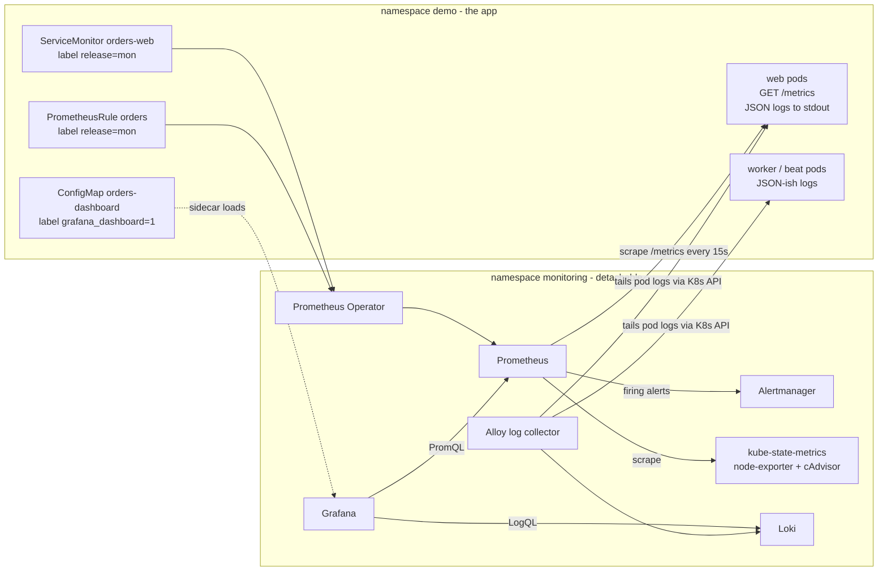

# Phase 4: Observability (metrics, dashboards, alerts, logs), and how to detach it

Goal: see what the app is doing (metrics + logs), get told when users are hurt (alert), and keep all
of it OPTIONAL so the app can run with or without it.

## Architecture



Two halves, deliberately separated:
| Half | Where | Helm release(s) | Needed for the app to run? |
|---|---|---|---|
| **Stack** (Prometheus, Alertmanager, Grafana, Loki, Alloy) | namespace `monitoring` | `mon`, `loki`, `alloy` | No |
| **App hooks** (`/metrics`, JSON logs, ServiceMonitor, PrometheusRule, dashboard) | namespace `demo`, inside the `orders` release | `orders` | Only `/metrics` + JSON logs are in the image; the three K8s objects are behind `observability.enabled` |

## Steps

### 1. Instrument the app
- `django-prometheus` (`uv add django-prometheus`): middleware first and last in `MIDDLEWARE`, `django_prometheus` in `INSTALLED_APPS`, URLs `path("", include("django_prometheus.urls"))` gives `GET /metrics`. The DB engine `django_prometheus.db.backends.postgresql` adds DB metrics.
- `/metrics` is NOT in the Ingress rules (`/api` and `/` only), so the internet can't read it; Prometheus scrapes pods directly.
- **gunicorn changed to 1 process + 4 threads** (`--workers 1 --threads 4 --worker-class gthread`). Metrics live in process memory; with N processes each scrape would hit a random one and counters would jump around. One process is consistent; scale with pods/HPA. (Alternative: `prometheus_client` multiprocess mode.)
- **Structured logging** (`uv add python-json-logger`): `LOG_FORMAT=json` makes every app log a JSON object per line; gunicorn's access log uses a JSON `--access-logformat`. Loki can then filter with `| json | status="500"`.

### 2. Install the stack (separate namespace, pinned versions)
```bash
./scripts/monitoring-up.sh
```
| Release | Chart (pinned) | Values | Notes |
|---|---|---|---|
| `mon` | `prometheus-community/kube-prometheus-stack` 92.17.0 | `observability/kps-values.yaml` | Operator + Prometheus + Alertmanager + Grafana + kube-state-metrics + node-exporter. Disabled kind-incompatible targets (etcd, scheduler, controller-manager, proxy). Grafana admin password comes from a random Secret created by the script. |
| `loki` | `grafana/loki` 7.5.0 | `observability/loki-values.yaml` | Single-binary mode, filesystem storage on a 2Gi PVC. No auth (single tenant). |
| `alloy` | `grafana/alloy` 1.15.0 | `observability/alloy-values.yaml` | Log collector (Promtail is end-of-life). Tails pods in `demo` through the K8s API and pushes to Loki. |

Order matters: `mon` first because it installs the CRDs (`ServiceMonitor`, `PrometheusRule`) the app chart renders.

### 3. Tell Prometheus about the app (in the app chart, `observability.enabled: true`)
- `templates/servicemonitor.yaml`: select the `orders-web` Service, port `http`, path `/metrics`, every 15s. Label **`release: mon`**: the stack's Prometheus only selects objects with its own release label (`serviceMonitorSelectorNilUsesHelmValues: true`). Forget the label and the target silently never appears.
- `templates/prometheusrule.yaml`: three alerts (below).
- `templates/grafana-dashboard.yaml` + `files/dashboard.json`: a ConfigMap labelled `grafana_dashboard: "1"`; Grafana's sidecar watches all namespaces and loads it. No clicking in the UI, and the dashboard is version-controlled.

### 4. The dashboard (RED + USE)
| Panel | PromQL idea | Method |
|---|---|---|
| Request rate | `sum(rate(django_http_requests_total_by_method_total[1m]))` | RED: Rate |
| 5xx ratio % | 5xx responses / all responses | RED: Errors |
| Latency p95 / p50 | `histogram_quantile(0.95, sum by (le)(rate(django_http_requests_latency_seconds_by_view_method_bucket[5m])))` | RED: Duration |
| Responses by status | `sum by (status)(rate(django_http_responses_total_by_status_total[1m]))` | |
| Pod CPU / memory | `container_cpu_usage_seconds_total`, `container_memory_working_set_bytes` (cAdvisor) | USE: Utilisation |
| Container restarts, ready replicas | kube-state-metrics | USE: Errors / saturation hints |
| Logs | Loki `{namespace="demo", container="web"} \| json` | |

### 5. Alerts (symptoms first)
| Alert | Expression (simplified) | Severity |
|---|---|---|
| `DjangoHighErrorRate` | 5xx ratio > 5% for 5m (1m in dev) | critical: users are failing |
| `DjangoPodRestarting` | > 3 container restarts in 15m | warning: crash loop / OOM |
| `DjangoWebDown` | no healthy `up == 1` target for 2m | critical |

Alert on symptoms (error rate, latency, availability) that a human must act on; use cause metrics (CPU, restarts) as lower-severity hints.
The annotation `{{ $labels.pod }}` is Go-template syntax that Helm would try to render, so the chart escapes it as `` {{ `{{ $labels.pod }}` }} ``.

### 6. Look at it
```bash
kubectl -n monitoring get secret grafana-admin -o jsonpath='{.data.admin-password}' | base64 -d; echo
kubectl -n monitoring port-forward svc/mon-grafana 3001:80                        # http://localhost:3001  user: admin
kubectl -n monitoring port-forward svc/mon-kube-prometheus-stack-prometheus 9090  # http://localhost:9090 (Status > Targets, Alerts)
kubectl -n monitoring port-forward svc/mon-kube-prometheus-stack-alertmanager 9093 # http://localhost:9093
```
Grafana: Dashboards > "Django Orders - RED/USE"; Explore > Loki > `{namespace="demo"} | json`.
Generate traffic: `for i in $(seq 1 200); do curl -s localhost:8080/api/orders/ >/dev/null; done`

## Detaching observability (the answer to "can we remove it?")
Yes, in two layers:
```bash
./scripts/monitoring-down.sh      # remove everything
./scripts/monitoring-up.sh        # put it back
```
What `monitoring-down.sh` does:
1. `helm upgrade orders ... --set observability.enabled=false`: the app chart stops rendering ServiceMonitor, PrometheusRule and the dashboard. **This must come first**: those kinds need the CRDs, and removing the CRDs first would fail the app release.
2. `helm uninstall alloy loki mon -n monitoring` and `kubectl delete ns monitoring` (removes PVCs and the Grafana Secret).
3. Delete the `*.monitoring.coreos.com` CRDs (Helm never deletes CRDs, by design).

What stays in the app image/chart regardless (harmless, no dependency on the stack): the `/metrics` endpoint and JSON stdout logging. If you don't want even those, set `LOG_FORMAT=text` in values; `/metrics` is just an unrouted URL.

Permanent opt-out for an environment: leave `observability.enabled: false` (the default in `values.yaml`). Only `values-dev.yaml` turns it on.
Test: `./scripts/phase4-detach-test.sh` removes the stack, asserts the app pods are byte-for-byte unchanged and still serving, then re-attaches.

## Tests
- `./scripts/phase4-verify.sh`: 24 checks (stack up, objects exist, target `up==1`, metrics/p95/cAdvisor queries, rule loaded, `/metrics` not public, dashboard + both datasources in Grafana, Grafana->Loki healthy, JSON logs, Loki query with `| json`) plus an **alert drill**: scale Postgres to 0, hit a web pod directly so 5xx are produced, wait for `DjangoHighErrorRate` to reach `firing` in Prometheus and appear in Alertmanager, then restore Postgres. (`--skip-alert` skips the ~4 min drill.)
- `./scripts/phase4-detach-test.sh`: detach, assert, re-attach.

## Problems we hit (interview stories)
1. **Loki `CrashLoopBackOff`: `mkdir /var/loki: read-only file system`.** With persistence off the chart gave no writable volume and our security posture has a read-only root fs. Fix: small PVC. Lesson: read-only rootfs means every writable path must be an explicit volume.
2. **All Prometheus checks failed but Grafana passed.** The Service is named `mon-kube-prometheus-stack-prometheus` (release `mon` + chart name), not `mon-kube-prometheus-prometheus`. Diagnosed with `kubectl -n monitoring get svc`. Test scripts now use the real names.
3. **Alert drill needs to bypass the Ingress.** With Postgres down, `/readyz` fails, pods leave the Service, and Ingress returns its own 503, which Django never counts. Port-forwarding to one pod produces real Django 5xx. This is itself a good point: readiness protects users, so a metric from Django alone can't see "all pods unready"; `DjangoWebDown` and kube-state-metrics cover that.

## Interview prep
**Talking point:** "I added metrics, logs and alerting as a detachable layer. Django exports Prometheus metrics, and the Helm chart ships a ServiceMonitor, a PrometheusRule and a Grafana dashboard behind one flag. Logs are JSON on stdout, collected by Alloy into Loki. I alert on the symptom, 5xx ratio, and proved it end to end by taking Postgres down and watching the alert fire in Alertmanager. The whole stack lives in its own namespace and can be removed without touching the app."

| Question | Short answer |
|---|---|
| Pull vs push monitoring? | Prometheus pulls (scrapes) targets, so it knows when a target is down (`up == 0`). Push (Pushgateway) only for short batch jobs. |
| What is a ServiceMonitor? | CRD from the Prometheus Operator describing which Services/ports/paths to scrape; the operator turns it into Prometheus scrape config. |
| Why did the target not show up? | Usually label mismatch (`release: mon`), wrong port name, or Service selector matching no pods. Check Status > Targets and `kubectl get endpoints`. |
| RED vs USE? | RED (Rate, Errors, Duration) for services/requests; USE (Utilisation, Saturation, Errors) for resources like CPU, memory, disks. |
| Why alert on symptoms? | Pages should mean users are affected and a human must act. Cause alerts (CPU 80%) create noise. |
| Counter vs gauge vs histogram? | Counter only goes up (use `rate()`); gauge goes up and down; histogram buckets values so you can compute percentiles with `histogram_quantile`. |
| Why p95 not average? | Averages hide tail latency; p95/p99 show what slow users see. |
| Metrics vs logs vs traces? | Metrics = what/how much (cheap, aggregated); logs = details of one event; traces = path of one request across services (OpenTelemetry). |
| Loki vs Elasticsearch? | Loki indexes only labels and stores compressed log chunks: far cheaper, queries are label filter + grep/`json`. ES full-text indexes everything. |
| Why not label by user_id? | High-cardinality labels explode time series count and memory. |
| What's missing for production? | Persistent Prometheus + long-term storage (Thanos/AMP/Mimir), HA Alertmanager with real receivers (Slack/PagerDuty), tracing (OpenTelemetry + Tempo/X-Ray), SLO burn-rate alerts, Loki on S3, auth on Grafana. |
