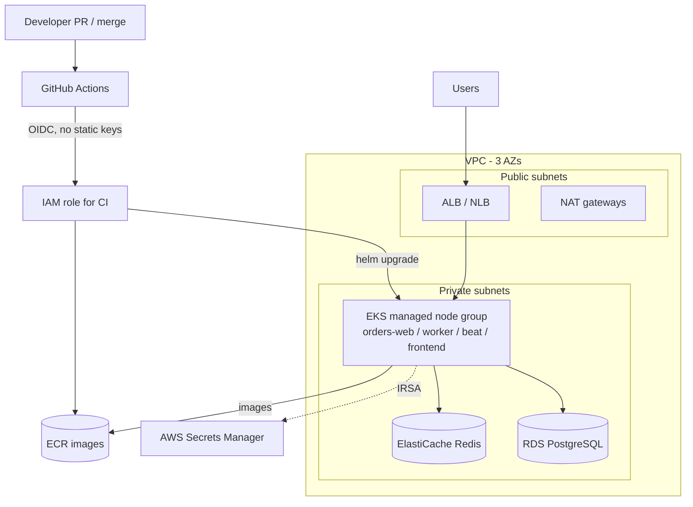

# Phase 6: AWS (Terraform + EKS) and CI/CD on paper (PLANNED, documentation only)

> **Status: not implemented yet.** This is the design and the interview material. No Terraform files, workflows or
> Jenkinsfile exist in the repo yet, Terraform isn't installed on this Mac, and nothing here has been run.
> Module names and version constraints below must be checked with `terraform init` / the Terraform Registry when
> we build it. **Never create real AWS resources**: only `terraform init`, `validate` and (with fake credentials or
> a sandbox account) `plan`.

Goal: show how the local project would reach AWS EKS: infrastructure as code, a secure pipeline with no static
keys, and how this compares to Jenkins.

## Target architecture on AWS

Local-to-AWS mapping:
| Local (kind) | AWS |
|---|---|
| kind node | EKS managed control plane + managed node group (EC2) |
| ingress-nginx on port 8080 | ingress-nginx or AWS Load Balancer Controller behind an NLB/ALB, TLS via ACM |
| Postgres / Redis StatefulSets | RDS PostgreSQL / ElastiCache Redis (managed, backed up, Multi-AZ) |
| `scripts/create-secrets.sh` | External Secrets Operator + AWS Secrets Manager, using IRSA |
| `kind load docker-image` | Push to ECR, nodes pull with their IAM role |
| local StorageClass | EBS CSI driver (gp3) |
| kindnet | AWS VPC CNI (pods get VPC IPs) |
| metrics-server (insecure TLS) | metrics-server (normal TLS) |
| monitoring stack | same Helm charts, or Amazon Managed Prometheus + Grafana |

## Part A: Terraform (`terraform/eks/`)
Planned files:
```
terraform/eks/
  backend.tf      # S3 state + DynamoDB lock (or S3 native locking)
  main.tf         # vpc module + eks module + (optional) ECR repos, GitHub OIDC provider and CI role
  variables.tf    # region, cluster name, k8s version, node sizes, azs
  outputs.tf      # cluster name, endpoint, OIDC provider ARN, ECR URLs, CI role ARN
  terraform.tfvars.example
```

### Design decisions to implement
| Topic | Decision | Why |
|---|---|---|
| VPC | `terraform-aws-modules/vpc/aws`, 3 AZs, public + private subnets, one NAT per AZ for prod (single NAT for cost in dev) | AZ failure tolerance; nodes never have public IPs |
| Subnet tags | `kubernetes.io/role/elb` on public, `kubernetes.io/role/internal-elb` on private | Lets the load balancer controller discover subnets |
| EKS | `terraform-aws-modules/eks/aws`, managed node group in **private** subnets, current supported Kubernetes version | AWS patches and manages the control plane; managed node groups handle AMI rollouts |
| IRSA | `enable_irsa = true` (OIDC provider for the cluster) | Pods assume IAM roles via service account tokens instead of node-wide permissions |
| Control plane access | Private endpoint + restricted public CIDRs | Don't expose the API to the internet |
| Secrets encryption | KMS key for Kubernetes Secrets (envelope encryption) | Secrets are base64 in etcd otherwise |
| Add-ons | `vpc-cni`, `coredns`, `kube-proxy`, `aws-ebs-csi-driver`, (optional) `aws-load-balancer-controller`, Karpenter or Cluster Autoscaler | Needed for networking, storage and scaling |
| State | S3 bucket (versioned, encrypted, no public access) with locking | Shared state; locking prevents two applies colliding |
| Workflow | `plan` on every PR (posted as a comment), `apply` only on merge to main, via a protected environment | Review before change; no laptop applies |
| Drift | scheduled `terraform plan` in CI; `terraform import` for resources created by hand | Detect console changes |

### What "done" looks like for this part
```bash
cd terraform/eks
terraform fmt -check
terraform init -backend=false     # no real backend needed to validate
terraform validate                 # must print: Success! The configuration is valid.
# Optional, with fake or sandbox credentials only:
terraform plan -var-file=terraform.tfvars.example
```

## Part B: GitHub Actions (`.github/workflows/ci.yaml`)
Pipeline stages:
| Stage | Runs on | What |
|---|---|---|
| 1. Lint and test | every PR and push | `uv sync`, `ruff`, `python manage.py test` against a Postgres service container; `npm ci`, lint, build; `helm lint`; `terraform fmt` and `validate` |
| 2. Build and scan | PR and main | `docker build` for both images (BuildKit cache), **Trivy** scan: fail on HIGH/CRITICAL fixable vulnerabilities |
| 3. Push | main only | Log in to ECR using **OIDC**, tag images with the git SHA, push |
| 4. Deploy | main only, protected environment | Configure kubeconfig (`aws eks update-kubeconfig`), `helm upgrade --install orders charts/django-app -f values-prod.yaml --set image.backend.tag=$SHA --set image.frontend.tag=$SHA --rollback-on-failure --timeout 10m` |
| 5. Post-deploy | main | Smoke test `/readyz` through the Ingress; on failure `helm rollback` |

### No static keys: GitHub OIDC to AWS
1. Create an IAM OIDC identity provider for `token.actions.githubusercontent.com` (Terraform).
2. Create an IAM role whose **trust policy** only allows this repo and branch, for example:
```json
{
  "Effect": "Allow",
  "Principal": {"Federated": "arn:aws:iam::<ACCOUNT_ID>:oidc-provider/token.actions.githubusercontent.com"},
  "Action": "sts:AssumeRoleWithWebIdentity",
  "Condition": {
    "StringEquals": {"token.actions.githubusercontent.com:aud": "sts.amazonaws.com"},
    "StringLike":   {"token.actions.githubusercontent.com:sub": "repo:sandip-gavade/k8_local_demo:ref:refs/heads/main"}
  }
}
```
3. Role permissions: push to the two ECR repos, `eks:DescribeCluster`; mapped into the cluster (EKS access entry or `aws-auth`) with only the RBAC it needs.
4. Workflow uses `permissions: {id-token: write, contents: read}` and `aws-actions/configure-aws-credentials` with `role-to-assume`. The token is short-lived and can't be used from a fork or another branch.

### Workflow skeleton (outline only)
```yaml
name: ci
on:
  pull_request:
  push: {branches: [main]}
permissions: {contents: read}
jobs:
  test:        # lint + unit tests + helm lint + terraform validate
  build-scan:  # needs: test. build images, trivy (exit-code 1 on HIGH,CRITICAL)
  push:        # needs: build-scan. if main. permissions: id-token: write. OIDC -> ECR push (tag = github.sha)
  deploy:      # needs: push. environment: production (manual approval). OIDC -> helm upgrade --rollback-on-failure
```
Pin third-party actions to a commit SHA, not a moving tag.

## Part C: Jenkinsfile (comparison, `Jenkinsfile`)
Same stages in declarative syntax:
```groovy
pipeline {
  agent { kubernetes { yaml '''...pod with docker/kaniko, helm, aws cli...''' } }
  stages {
    stage('Test')       { steps { sh 'uv sync && uv run python manage.py test && helm lint charts/django-app' } }
    stage('Build+Scan') { steps { sh 'docker build ... && trivy image --exit-code 1 --severity HIGH,CRITICAL ...' } }
    stage('Push')       { when { branch 'main' } steps { withAWS(role: 'ci-role') { sh 'ecr login + push' } } }
    stage('Deploy')     { when { branch 'main' } steps { input 'Deploy to prod?'; sh 'helm upgrade --install ... --rollback-on-failure' } }
  }
}
```
| | GitHub Actions | Jenkins | Concourse |
|---|---|---|---|
| Hosting | SaaS (or self-hosted runners) | Self-hosted server + agents | Self-hosted |
| Config | YAML workflows in repo | Jenkinsfile (Groovy) | YAML pipelines: resources, jobs, tasks |
| AWS auth | OIDC, no stored keys | IAM role on the agent (IRSA/instance profile) or plugin | IAM role on workers, or credential manager |
| Extensibility | Marketplace actions | Large plugin ecosystem (maintenance burden) | Few primitives, containers everywhere, reproducible |
| Strength | Close to the code, zero ops | Flexible, mature, on-prem | Clean model: every step in a fresh container |

## Part D: Deployment strategy talking points
| Topic | Plan |
|---|---|
| Pre-merge vs post-merge | Pre-merge: lint, unit tests, helm lint, terraform validate, image build + scan, `plan`. Post-merge: push, deploy, smoke test |
| Rolling update | Default: `maxUnavailable: 0` (already in the chart) |
| Canary / progressive | Argo Rollouts or Flagger with ingress-nginx weights; analysis step queries Prometheus (5xx ratio, p95) |
| Auto rollback | `--rollback-on-failure` for failed rollouts; metric-based abort for canaries |
| GitOps | Argo CD or Flux watching the chart + values repo as the deploy mechanism instead of `helm upgrade` from CI |
| Secrets | External Secrets Operator reading AWS Secrets Manager with IRSA; never in values files |
| Image supply chain | Trivy scan, pin base image digests, sign with cosign, SBOM |

## Interview prep
**Talking point (for when it is built):** "I wrote Terraform with the community VPC and EKS modules: three AZs,
private node subnets, a managed node group, IRSA, and an S3 backend with locking, validated but never applied.
The GitHub Actions pipeline tests, builds, scans with Trivy, and pushes to ECR through an OIDC role, so there are no
long-lived AWS keys, then runs `helm upgrade --rollback-on-failure`. I also wrote the Jenkins equivalent."

| Question | Short answer |
|---|---|
| What does EKS manage vs you? | AWS runs the control plane (API server, etcd, scheduler); you manage nodes (or use Fargate/Karpenter), add-ons, workloads, IAM mapping. |
| IRSA? | The cluster's OIDC provider lets a ServiceAccount token be exchanged for an IAM role, so each pod gets least-privilege AWS access instead of the node's role. Newer alternative: EKS Pod Identity. |
| VPC CNI? | Pods get real VPC IPs from node ENIs, so the number of pods per node is limited by ENI/IP counts; consider prefix delegation. |
| Why private subnets for nodes? | No public IPs; egress via NAT, ingress only through load balancers. |
| ALB controller vs ingress-nginx? | ALB controller provisions AWS ALBs from Ingress objects (L7, WAF, ACM); ingress-nginx runs in-cluster behind one NLB. |
| Karpenter vs Cluster Autoscaler? | Karpenter provisions right-sized nodes directly from pending pods (faster, bin-packing, spot); CA scales pre-defined node groups. |
| Terraform state? | Remote in S3 with locking, encrypted and versioned; never commit state (it contains secrets). |
| Plan on PR, apply on merge? | Reviewers see the diff before it happens; apply is automated from one protected branch, not from laptops. |
| Drift? | Reality differs from state (console edits). Detect with scheduled plans; fix by apply or `terraform import`. |
| Why OIDC for CI? | Short-lived, scoped credentials bound to repo/branch; nothing to leak or rotate. |
| Trivy in CI? | Fail the build on fixable HIGH/CRITICAL CVEs; scan images and IaC; ignore list with expiry for accepted risk. |
| How would you do a canary? | Argo Rollouts/Flagger shifts 5%, 25%, 100% of traffic and queries Prometheus for errors/latency; aborts and rolls back automatically on SLO breach. |
| Map to your real work | RefundStacker (Django, Celery, Redis, Postgres) is this same app shape; the GCP migration design and Infosys AWS CloudFormation + CI/CD map to Terraform + EKS and the pipeline above. |
